<p align="center"><picture><source media="(prefers-color-scheme: dark)" srcset="assets/graficos/cabecera-oscuro.webp">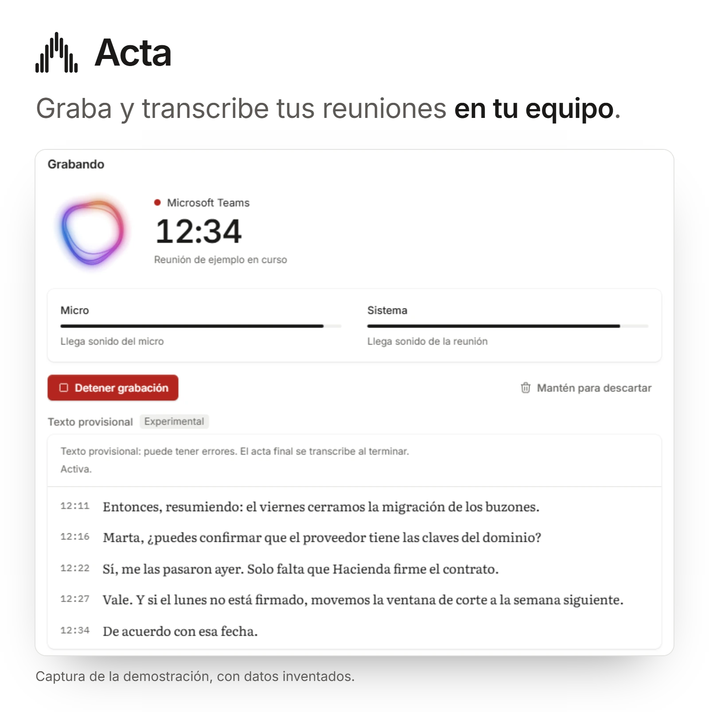</picture></p>

<p>
<picture><source media="(prefers-color-scheme: dark)" srcset="assets/graficos/chip-local-oscuro.webp">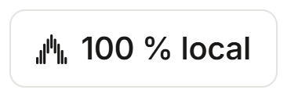</picture> <picture><source media="(prefers-color-scheme: dark)" srcset="assets/graficos/chip-cuentas-oscuro.webp">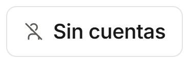</picture> <picture><source media="(prefers-color-scheme: dark)" srcset="assets/graficos/chip-nube-oscuro.webp"></picture> <picture><source media="(prefers-color-scheme: dark)" srcset="assets/graficos/chip-windows-oscuro.webp">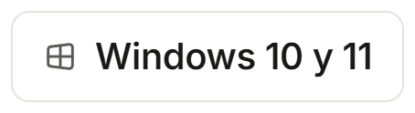</picture> <picture><source media="(prefers-color-scheme: dark)" srcset="assets/graficos/chip-android-oscuro.webp">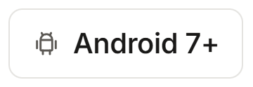</picture> <picture><source media="(prefers-color-scheme: dark)" srcset="assets/graficos/chip-firma-oscuro.webp">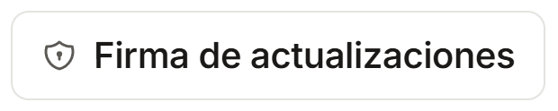</picture>
</p>

<p align="center">
<a href="https://github.com/Ja1zme/acta-releases/releases/latest"><picture><source media="(prefers-color-scheme: dark)" srcset="assets/graficos/boton-windows-oscuro.webp">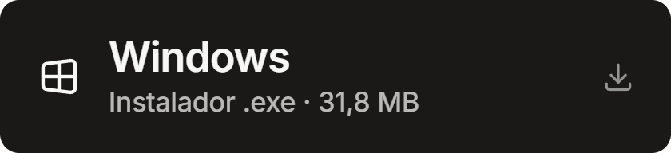</picture></a>
</p>

<p align="center">
<a href="https://github.com/Ja1zme/acta-releases/releases/tag/movil-v0.4.0"><picture><source media="(prefers-color-scheme: dark)" srcset="assets/graficos/boton-android-oscuro.webp">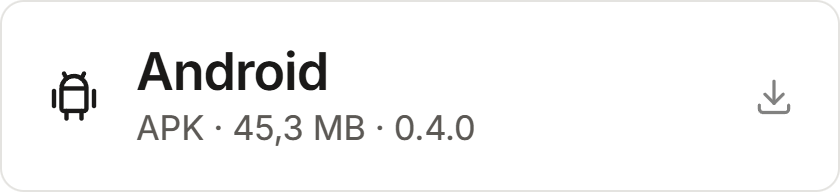</picture></a>
</p>

## Cómo funciona

<p align="center"><picture><source media="(prefers-color-scheme: dark)" srcset="assets/graficos/pasos-oscuro.webp">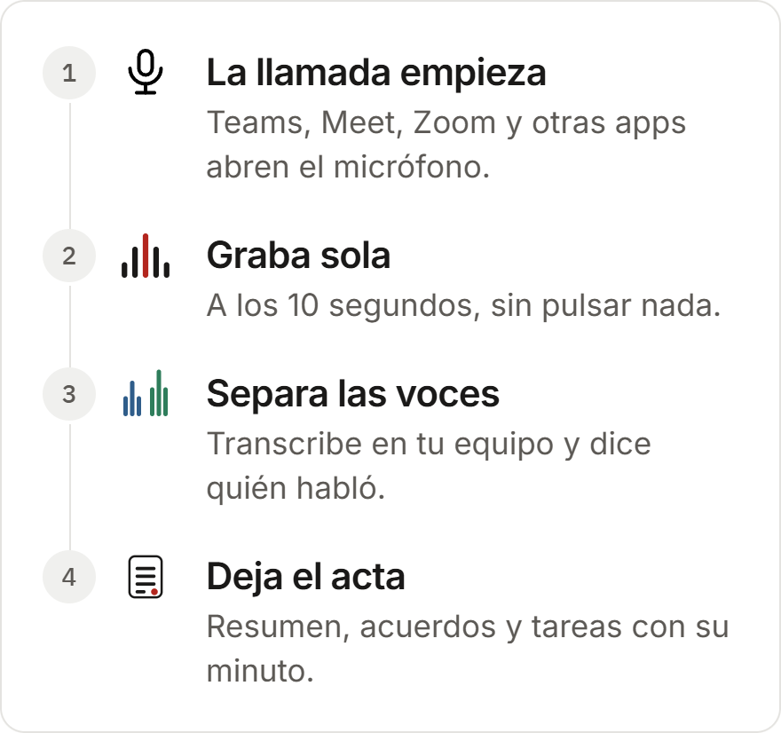</picture></p>

## Funciones

<p align="center"><picture><source media="(prefers-color-scheme: dark)" srcset="assets/graficos/f-grabar-oscuro.webp">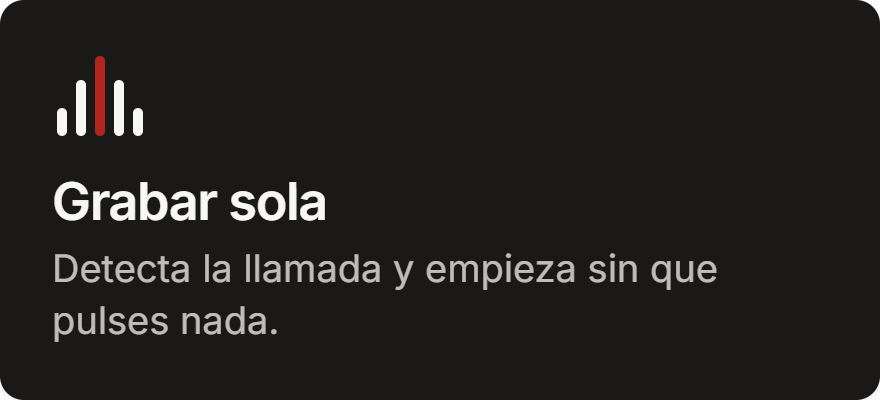</picture></p>

<p align="center"><picture><source media="(prefers-color-scheme: dark)" srcset="assets/graficos/f-voces-oscuro.webp">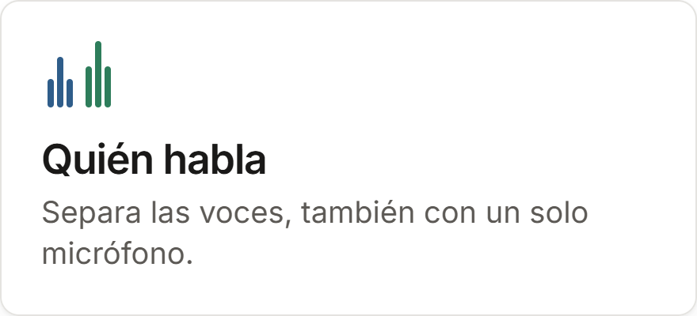</picture></p>

<p align="center"><picture><source media="(prefers-color-scheme: dark)" srcset="assets/graficos/f-acta-oscuro.webp">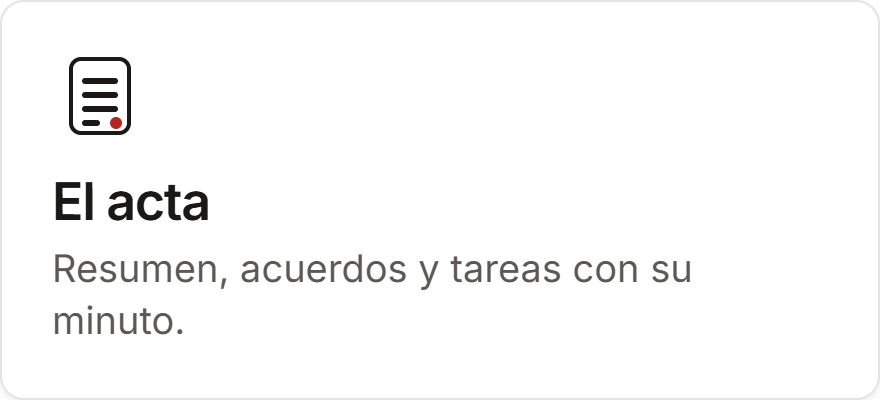</picture></p>

<p align="center"><picture><source media="(prefers-color-scheme: dark)" srcset="assets/graficos/f-preguntar-oscuro.webp">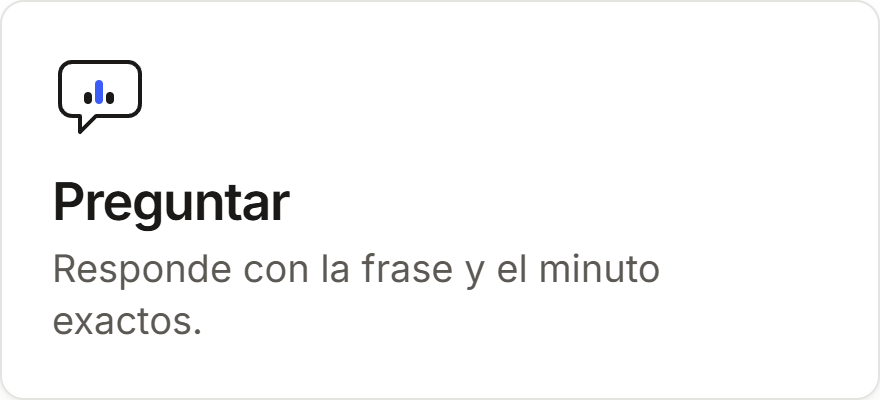</picture></p>

<p align="center"><picture><source media="(prefers-color-scheme: dark)" srcset="assets/graficos/f-dictar-oscuro.webp">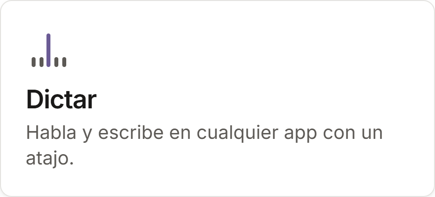</picture></p>

<p align="center"><picture><source media="(prefers-color-scheme: dark)" srcset="assets/graficos/f-pantalla-oscuro.webp">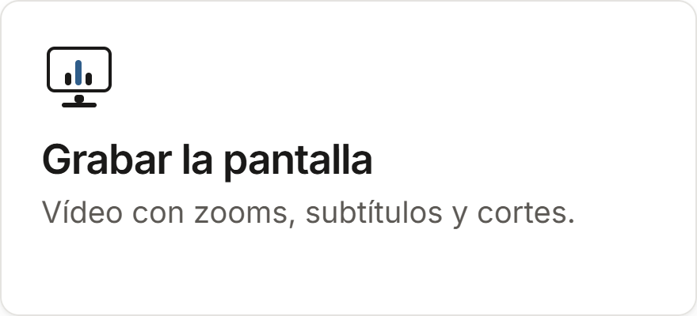</picture></p>

<p align="center"><picture><source media="(prefers-color-scheme: dark)" srcset="assets/graficos/f-calendario-oscuro.webp">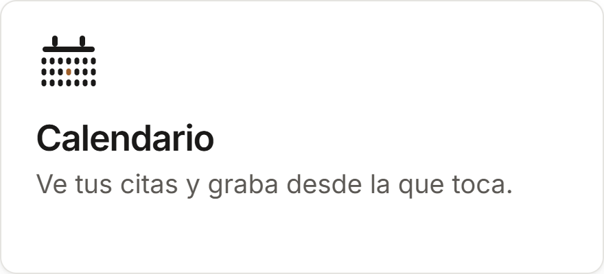</picture></p>

<p align="center"><picture><source media="(prefers-color-scheme: dark)" srcset="assets/graficos/f-movil-oscuro.webp">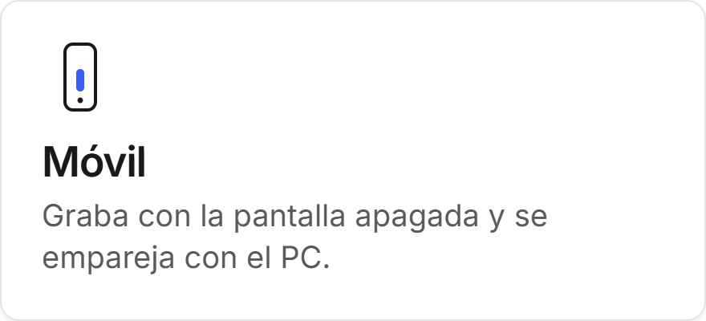</picture></p>

<p align="center"><picture><source media="(prefers-color-scheme: dark)" srcset="assets/graficos/f-privacidad-oscuro.webp">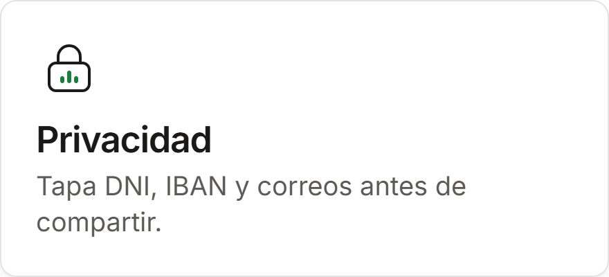</picture></p>

## Capturas

<p align="center"><picture><source media="(prefers-color-scheme: dark)" srcset="assets/capturas/hoy-oscuro.webp">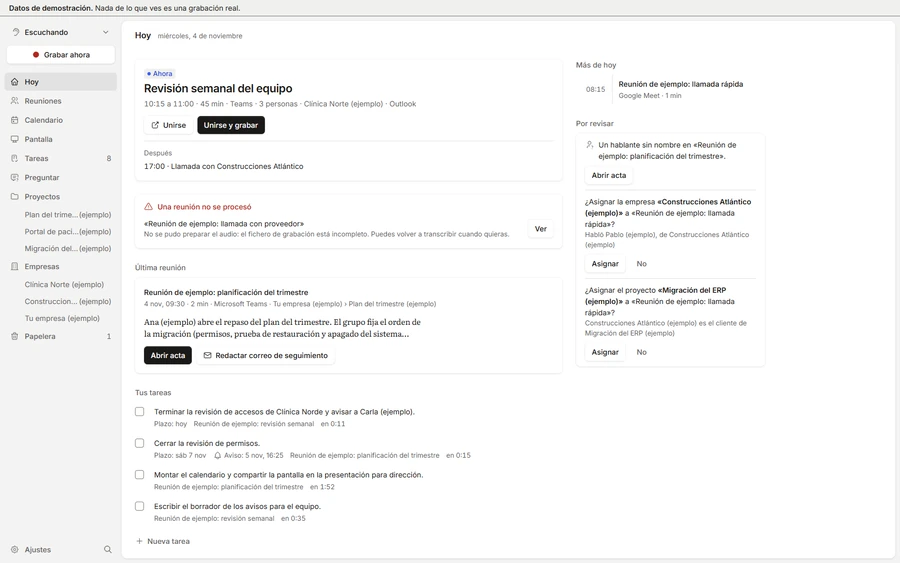</picture><br><sub>Hoy</sub></p>

<p align="center"><picture><source media="(prefers-color-scheme: dark)" srcset="assets/capturas/acta-oscuro.webp">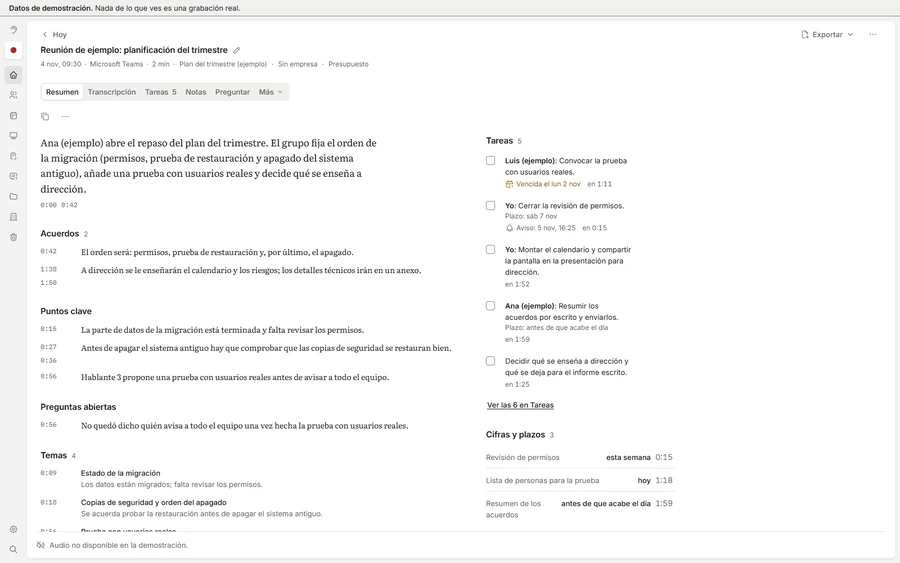</picture><br><sub>El acta</sub></p>

<p align="center"><picture><source media="(prefers-color-scheme: dark)" srcset="assets/capturas/pantalla-oscuro.webp">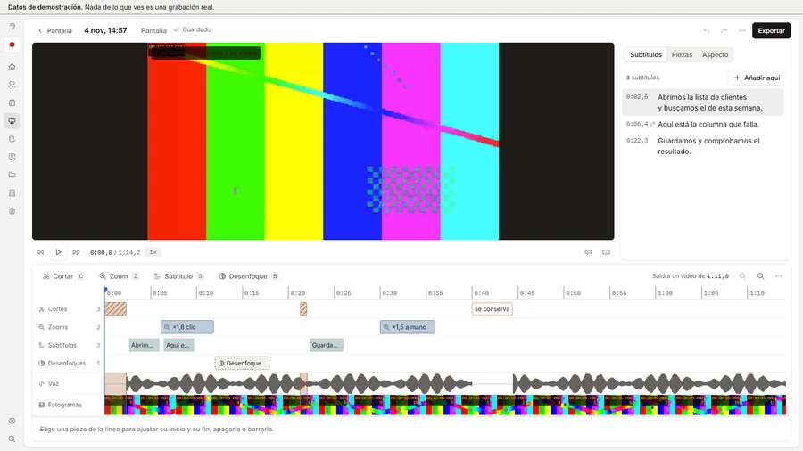</picture><br><sub>Grabar la pantalla</sub></p>

<p align="center"><picture><source media="(prefers-color-scheme: dark)" srcset="assets/capturas/calendario-oscuro.webp">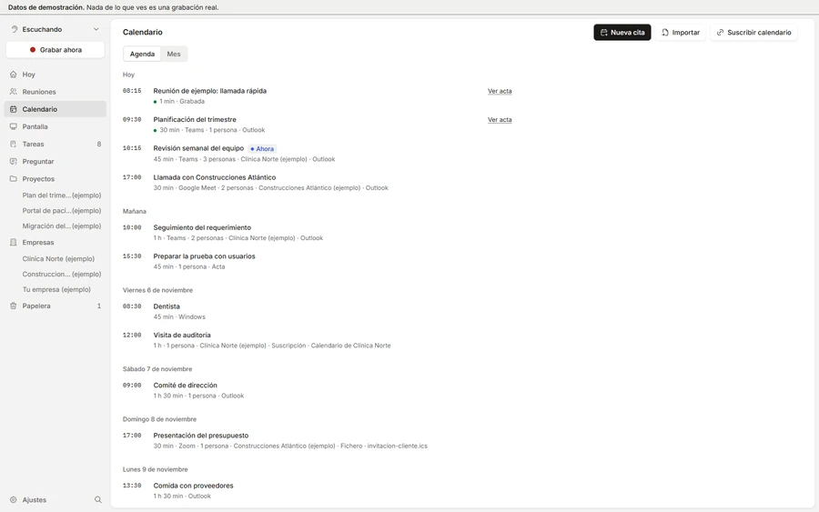</picture><br><sub>Calendario</sub></p>

<p align="center"><picture><source media="(prefers-color-scheme: dark)" srcset="assets/capturas/bienvenida-oscuro.webp">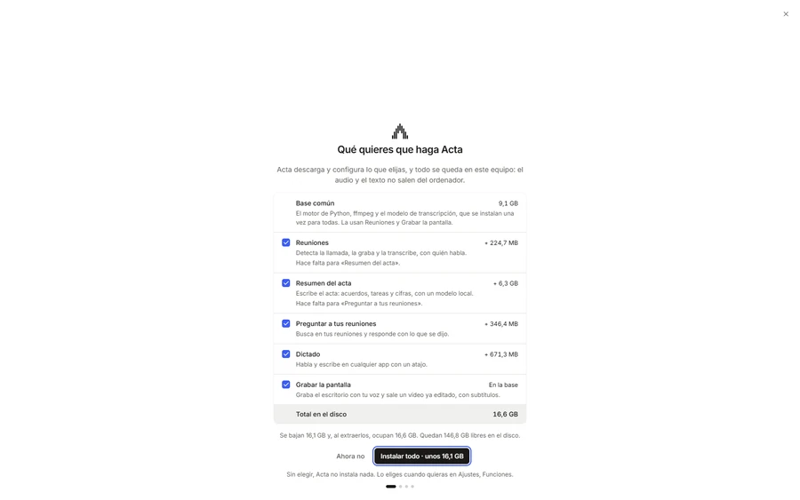</picture><br><sub>Bienvenida</sub></p>

<p align="center"><picture><source media="(prefers-color-scheme: dark)" srcset="assets/capturas/movil-oscuro.webp">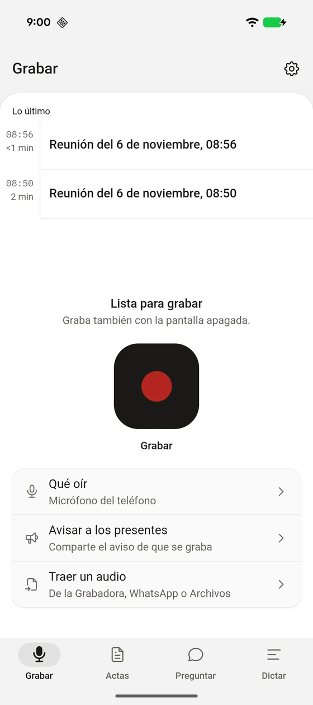</picture><br><sub>Móvil</sub></p>

<p align="center"><picture><source media="(prefers-color-scheme: dark)" srcset="assets/flujo-oscuro.gif"></picture><br><sub>De grabar al acta</sub></p>

<p align="center"><picture><source media="(prefers-color-scheme: dark)" srcset="assets/pantalla-oscuro.gif">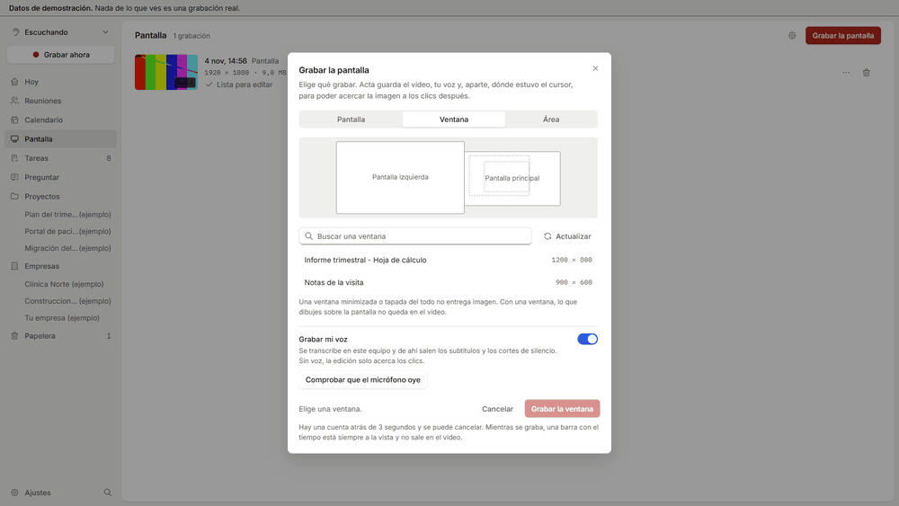</picture><br><sub>De la ventana al vídeo</sub></p>

## Privacidad

<p align="center"><picture><source media="(prefers-color-scheme: dark)" srcset="assets/graficos/privacidad-oscuro.webp">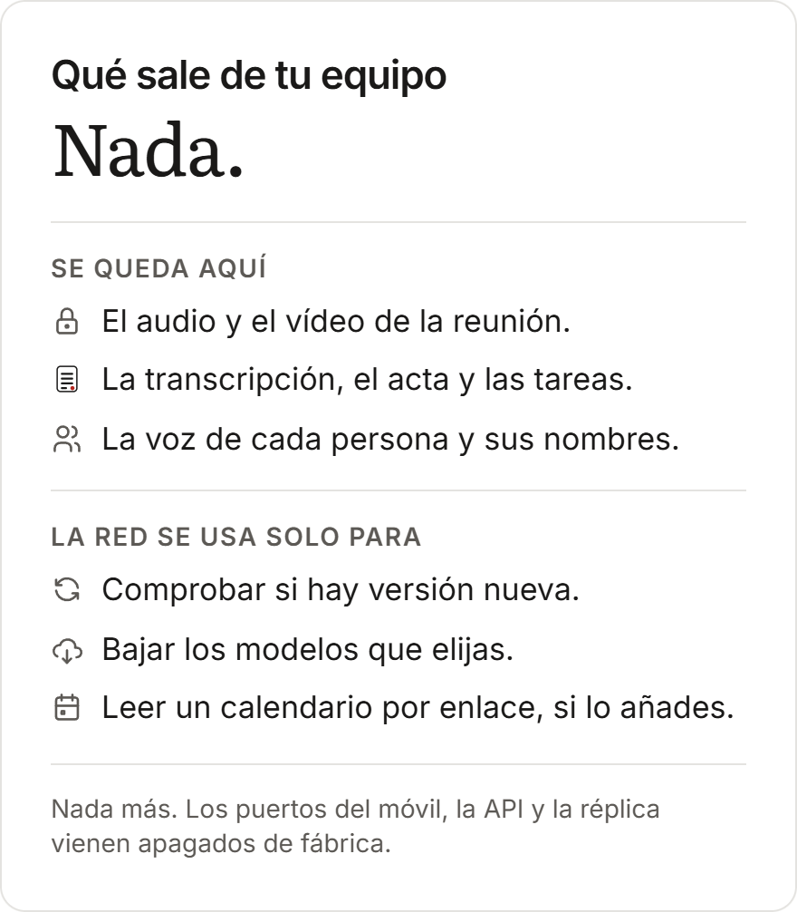</picture></p>

## Instalar

<p align="center"><picture><source media="(prefers-color-scheme: dark)" srcset="assets/graficos/instalar-windows-oscuro.webp">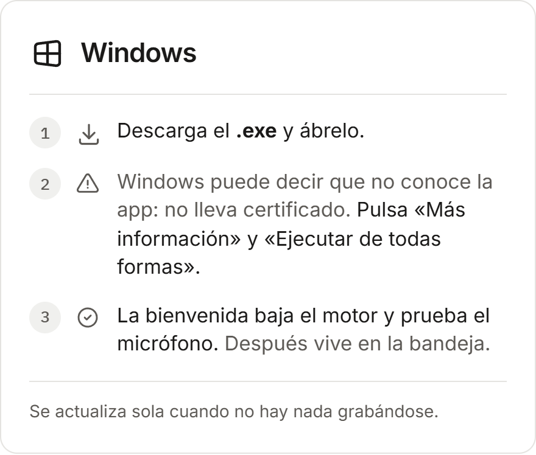</picture></p>

<p align="center"><picture><source media="(prefers-color-scheme: dark)" srcset="assets/graficos/instalar-android-oscuro.webp">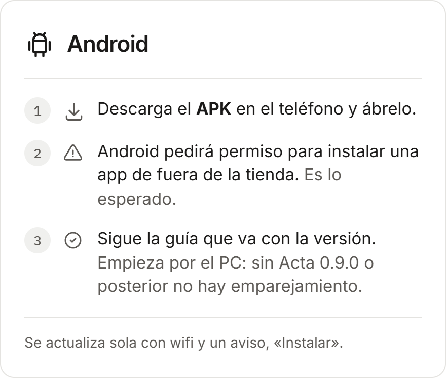</picture></p>

## Requisitos

| Plataforma | Requisitos |
|:--|:--|
| **Windows** | 10 (21H2 o posterior) u 11, de 64 bits. En disco, 5,3 GB, o 9,2 GB con una RTX, sin los modelos de resumen y pantalla. NVIDIA opcional; sin ella, el procesador. |
| **Android** | 7 o posterior, de 64 bits. El modelo de voz ocupa 207 MB o 670 MB, según el que elijas. |

Este repositorio solo guarda los instaladores.

<details>
<summary>Qué no hace</summary>

- No hay versión para Mac ni para Linux. La app del iPhone no se ha compilado ni probado: sin un Mac no se puede firmar.
- No hay nube: ni colaboración en línea, ni enlace para compartir, ni cuentas de ningún tipo.
- No graba las llamadas del móvil ni las de WhatsApp o Teams: Android no lo permite a una app normal. Acta abre la grabadora del sistema y trae la grabación.
- El instalador de Windows no lleva certificado de Windows. La firma que trae es la de las actualizaciones, la que comprueba cada copia antes de actualizarse.
- El código no se publica.

</details>

<details>
<summary>Comprobar la huella</summary>

GitHub muestra la huella SHA-256 de cada fichero junto a su enlace (`sha256:…`). Compárala con la del fichero que bajaste antes de instalar. En Windows:

```text
certutil -hashfile Acta_0.10.1_x64-setup.exe SHA256
```

En Android, la huella del APK y la del certificado de firma van en las notas de cada versión. El certificado del móvil es el mismo desde la 0.2.6, así que la 0.4.0 se instala encima sin desinstalar y sin perder las actas.

</details>

<details>
<summary>Canal de pruebas</summary>

La etiqueta `pruebas` guarda una versión de prueba con su `latest.json`. Se elige en Ajustes, «Apariencia», «Canal de actualizaciones». Acta no baja de versión al volver a Estable.

</details>

<details>
<summary>Aviso legal</summary>

Grabar una conversación en la que participas es lícito en España, pero tratar la voz de otras personas son datos personales. Avisa a los participantes de que la reunión se graba y se transcribe. Acta trae un aviso listo para copiar en el chat.

</details>
