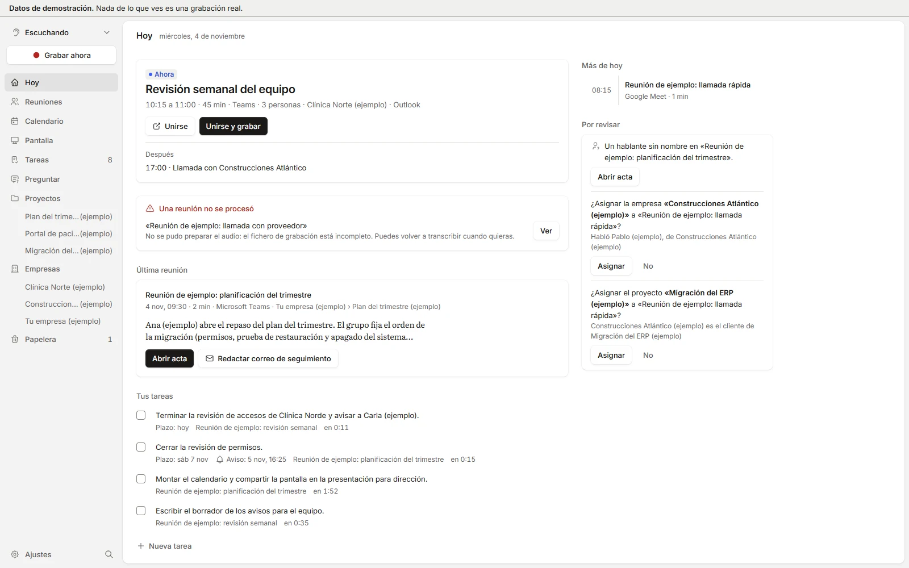
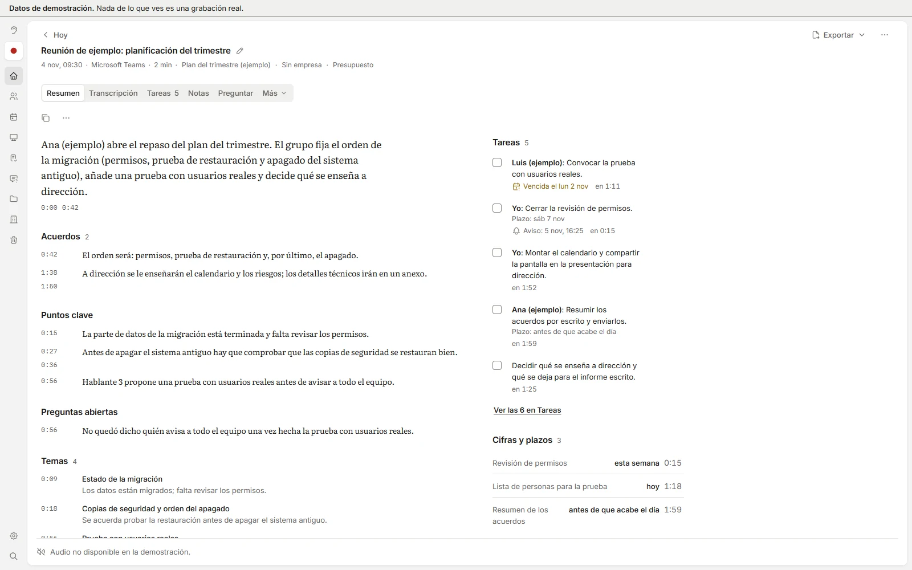
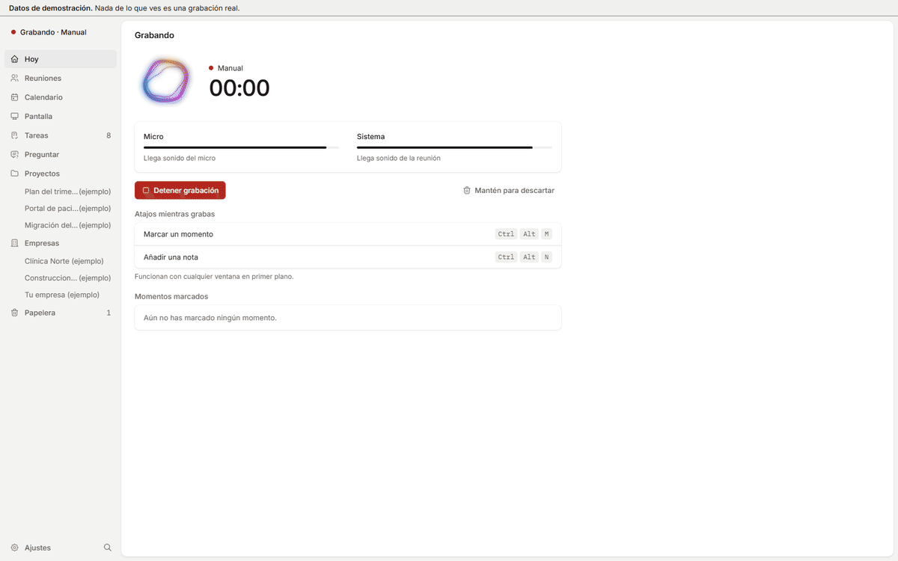
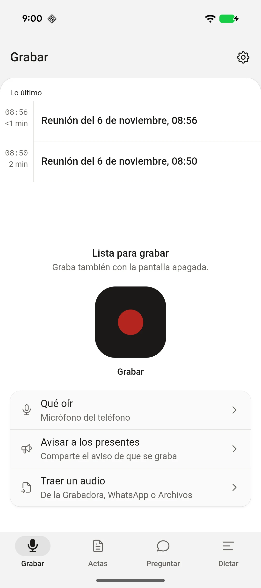
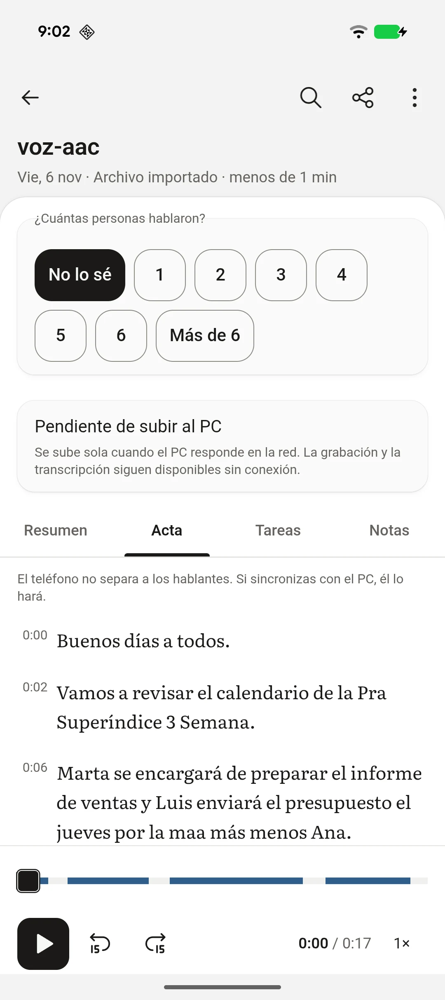

<picture>
  <source media="(prefers-color-scheme: dark)" srcset="logo-horizontal-dark.png">
  
</picture>

# Acta: descargas

Acta graba tus reuniones y las convierte en actas en tu propio equipo. Transcribe, separa a quién habla, resume, apunta las decisiones y las tareas. El audio no sale de tu ordenador y no hay cuentas ni nube. En **Windows** y en **Android**.

<picture>
  <source media="(prefers-color-scheme: dark)" srcset="assets/hoy-oscuro.webp">
  
</picture>

Capturas de la demostración, con datos inventados. La franja superior de cada una lo dice.

## Descargar

-  **Windows:** `Acta_x.y.z_x64-setup.exe` de la [última versión](https://github.com/Ja1zme/acta-releases/releases/latest).
-  **Android:** `Acta-x.y.z-arm64-v8a.apk` de las versiones que empiezan por `movil-v`, en [Releases](https://github.com/Ja1zme/acta-releases/releases). La guía de instalación va adjunta en cada una.

Este repositorio solo guarda los instaladores. El código no se publica.

## Qué hace

-  Graba solo. Detecta la llamada en Teams, Meet, Zoom, Webex, Slack y otras apps, y empieza a los 10 segundos de que la app use el micrófono.
-  Separa a los hablantes, también en una sala con un solo micrófono, y aprende la voz de cada persona cuando le pones nombre.
-  Deja el acta con el resumen, los acuerdos, los puntos clave, las preguntas abiertas y las tareas con responsable y plazo. Cada cita enlaza con el minuto en que se dijo.
-  Dicta en cualquier aplicación con un atajo, con un modelo de voz local.
-  El móvil graba con la pantalla apagada, transcribe en el teléfono y se empareja con el PC por la red local.
-  Detecta DNI, NIE, CIF, IBAN, teléfonos y correos, también dichos en voz, y los oculta antes de compartir el acta con un cliente.





## Instalar en Windows

1. Descarga el `.exe` y ábrelo.
2. Windows puede avisar de que el instalador no es una aplicación conocida: no lleva certificado de Windows. Es lo esperado. Pulsa «Más información» y «Ejecutar de todas formas».
3. Abre Acta una vez. La bienvenida descarga el motor de transcripción (varios GB, solo la primera vez) y prueba el micrófono. Después se queda en la bandeja.

**Pide:** Windows 10 (21H2 o posterior) u 11, de 64 bits. Con una tarjeta NVIDIA usa la gráfica; sin ella, el procesador. En disco, unos 5,3 GB sin GPU y unos 9,2 GB con una RTX, sin los modelos de resumen y de pantalla, que se añaden al terminar la primera reunión.

**Actualizaciones:** Acta lee aquí `latest.json` y se actualiza sola cuando no hay nada grabándose ni procesándose.

## Instalar en Android

1. Descarga el APK en el teléfono y ábrelo. Android pedirá permiso para instalar una app de fuera de la tienda.
2. Sigue la guía `INSTALAR-ANDROID.md` que acompaña a la versión. Empieza por el PC: sin Acta para Windows 0.9.0 o posterior no hay emparejamiento.

**Pide:** Android 7 o posterior, de 64 bits.

| Grabar | El acta en el teléfono |
|:---:|:---:|
| <picture><source media="(prefers-color-scheme: dark)" srcset="assets/movil-grabar-oscuro.webp"></picture> |  |

**Actualizaciones:** de momento, a mano. Instala el APK nuevo encima y se conservan tus actas.

## Qué no hace

- No hay versión para Mac ni para Linux, y la app del iPhone no se ha compilado ni probado: sin un Mac no se puede firmar.
- No hay nube: ni colaboración en línea, ni enlace para compartir, ni cuentas de ningún tipo.
- No graba las llamadas del móvil ni las de WhatsApp o Teams: Android no lo permite a una app normal. Acta abre la grabadora del sistema y trae la grabación.
- El instalador de Windows no está firmado con un certificado de Windows. La firma que trae es la de las actualizaciones, la que comprueba cada copia antes de actualizarse.

## Qué hace con la red

- Comprueba actualizaciones cada 6 horas.
- Descarga los modelos la primera vez y, si lo activas, los del dictado y los del resumen.
- Nada más. El audio y el texto no salen del equipo; la transcripción, los hablantes y el resumen corren en modelos locales.

Los puertos que abre (móvil, API local, réplica de lectura) vienen apagados de fábrica.

## Comprobar lo que descargas

GitHub muestra la huella SHA-256 de cada fichero junto a su enlace (`sha256:…`). Compárala con la del fichero que bajaste antes de instalar. En Windows:

```text
certutil -hashfile Acta_x.y.z_x64-setup.exe SHA256
```

En Android, la huella del APK y la del certificado de firma van en las notas de cada versión.

## Canal de pruebas

La etiqueta `pruebas` guarda una versión de prueba con su `latest.json`. Se elige en Ajustes, «Apariencia», «Canal de actualizaciones». Acta no baja de versión al volver a Estable.

## Aviso legal

Grabar una conversación en la que participas es lícito en España, pero tratar la voz de otras personas son datos personales. Avisa a los participantes de que la reunión se graba y se transcribe. Acta trae un aviso listo para copiar en el chat.
